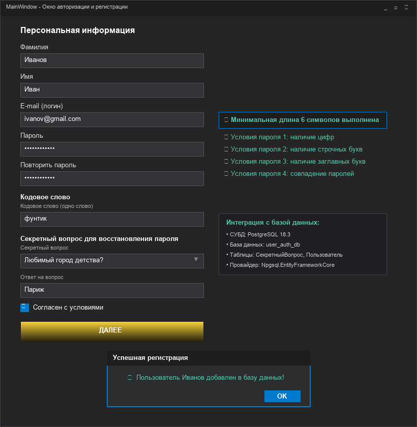
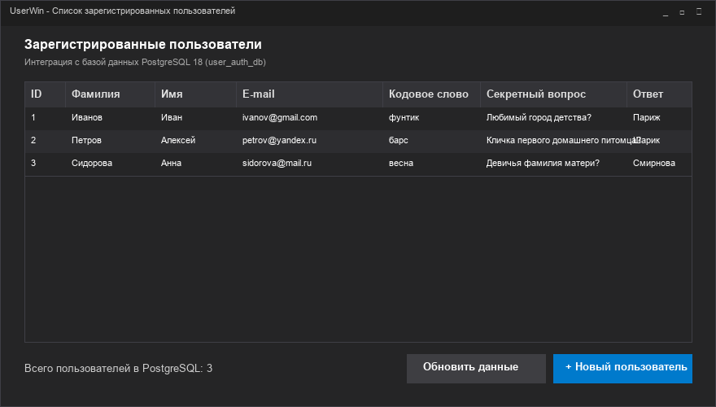
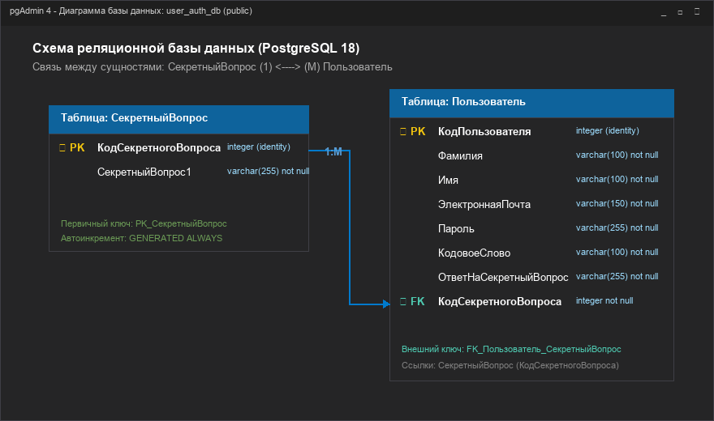
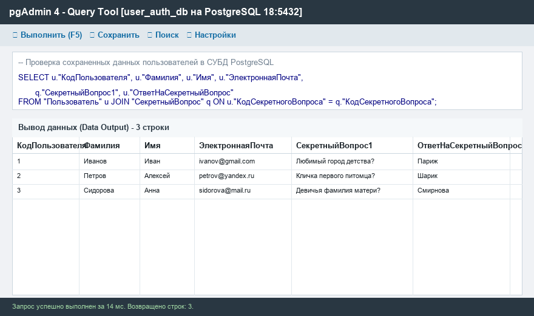

# Практическое занятие №8-9: Разработка и интеграция модулей проекта

[](https://dotnet.microsoft.com/)
[](https://www.postgresql.org/)
[](https://www.pgadmin.org/)
[](https://www.nuget.org/packages/Npgsql.EntityFrameworkCore.PostgreSQL)

Практическая работа по дисциплине **«Инструментальные средства разработки программного обеспечения» (ИСРПО)**.

**Тема:** Разработка модулей проекта (командная работа). Интеграция модулей проекта (командная работа).  
**Цель занятия:** закрепление практических навыков работы с языком C#, платформой WPF (.NET 8), реляционной СУБД PostgreSQL 18 и средой pgAdmin 4, проведение интеграции программных модулей пользовательского интерфейса, бизнес-логики и базы данных.

---

## 📸 Скриншоты работы приложения

| Окно регистрации и валидация пароля | Список пользователей из PostgreSQL (UserWin) |
|:---:|:---:|
|  |  |

| Диаграмма базы данных | Проверка данных в pgAdmin 4 |
|:---:|:---:|
|  |  |

---

## 🛠 Стек технологий и архитектура

- **Язык программирования:** C# 12 (.NET 8.0 Windows Desktop)
- **Пользовательский интерфейс:** Windows Presentation Foundation (WPF, XAML)
- **СУБД:** PostgreSQL 18
- **Инструмент администрирования БД:** pgAdmin 4
- **ORM / Слой доступа к данным:** Entity Framework Core (`Npgsql.EntityFrameworkCore.PostgreSQL 8.*`)
- **Архитектурный паттерн:** N-уровневая архитектура (UI -> DAL / ORM -> RDBMS)

### Структура базы данных (`user_auth_db`):
1. **`СекретныйВопрос`**:
   - `КодСекретногоВопроса` (`INT GENERATED ALWAYS AS IDENTITY PRIMARY KEY`)
   - `СекретныйВопрос1` (`VARCHAR(255) NOT NULL`)
2. **`Пользователь`**:
   - `КодПользователя` (`INT GENERATED ALWAYS AS IDENTITY PRIMARY KEY`)
   - `Фамилия`, `Имя`, `ЭлектроннаяПочта`, `Пароль`, `КодовоеСлово`, `ОтветНаСекретныйВопрос`
   - `КодСекретногоВопроса` (`INT NOT NULL REFERENCES "СекретныйВопрос"`)

---

## 🚀 Возможности приложения

1. **Окно регистрации и авторизации (`MainWindow.xaml`)**:
   - Персональные данные: Фамилия, Имя, E-mail (логин), пароль и повтор пароля.
   - **Интерактивная панель валидации пароля в реальном времени**:
     - Проверка минимальной длины (от 6 символов);
     - Условие 1: наличие цифр (`0-9`);
     - Условие 2: наличие строчных букв;
     - Условие 3: наличие заглавных букв;
     - Условие 4: проверка точного совпадения паролей.
   - Поле кодового слова *(одно слово)*.
   - Выпадающий список секретных вопросов, **динамически загружаемый из базы данных PostgreSQL** при старте (`Window_Loaded`).
   - Поле ответа на секретный вопрос.
   - Чекбокс обязательного согласия с условиями.
   - Стилизованная градиентная кнопка **«ДАЛЕЕ»** с добавлением пользователя в PostgreSQL, выводом уведомления `MessageBox` и переходом к списку пользователей.

2. **Окно просмотра пользователей (`UserWin.xaml`)**:
   - Таблица `DataGrid` со всеми зарегистрированными пользователями из PostgreSQL.
   - Отображение связанных данных секретного вопроса через `Include(u => u.СекретныйВопрос)`.
   - Кнопка возврата к форме регистрации и кнопка обновления списка.

---

## 📂 Структура проекта

```text
belous7-8/
├── BelousAuthApp.sln              # Решение Visual Studio
├── BelousAuthApp.slnx             # Файл решения .NET
├── BelousAuthApp/                 # Проект WPF C#
│   ├── BelousAuthApp.csproj       # Конфигурация проекта и NuGet пакеты
│   ├── appsettings.json           # Строка подключения к PostgreSQL
│   ├── App.xaml / App.xaml.cs     # Точка входа WPF
│   ├── MainWindow.xaml / .cs      # Окно авторизации / регистрации
│   ├── UserWin.xaml / .cs         # Окно со списком пользователей
│   ├── Models/                    # C#-модели сущностей
│   │   ├── Пользователь.cs        # Сущность Пользователь
│   │   └── СекретныйВопрос.cs     # Сущность СекретныйВопрос
│   └── Data/
│       └── AppDbContext.cs        # Контекст Entity Framework Core (Npgsql)
├── sql/
│   └── schema.sql                 # DDL-скрипт создания базы данных и таблиц
├── docs/                          # Документация и отчеты
│   ├── Отчет_ПР_8-9_Белоус.docx   # Полный отчет по ГОСТ/методичке (Times New Roman 12, 1.5)
│   ├── REPORT.md                  # Markdown-версия отчета для просмотра на GitHub
│   ├── pgadmin_guide.md           # Руководство по работе с pgAdmin 4
│   └── images/                    # Иллюстрации и скриншоты для отчета
└── README.md                      # Главное описание проекта
```

---

## ⚡ Инструкция по запуску

### 1. Подготовка базы данных в PostgreSQL / pgAdmin 4
Убедитесь, что служба PostgreSQL запущена (по умолчанию порт `5432`).

Выполните скрипт `sql/schema.sql` в **pgAdmin 4** (Query Tool) либо через командную строку `psql`:
```powershell
$env:PGPASSWORD = "postgres"
& "C:\PostgreSQL\18\bin\psql.exe" -h 127.0.0.1 -U postgres -d postgres -c "CREATE DATABASE user_auth_db;"
& "C:\PostgreSQL\18\bin\psql.exe" -h 127.0.0.1 -U postgres -d user_auth_db -f "sql/schema.sql"
```

### 2. Сборка и запуск WPF приложения
```powershell
# Сборка проекта
dotnet build BelousAuthApp.sln

# Запуск приложения
dotnet run --project BelousAuthApp/BelousAuthApp.csproj
```

---

## 📄 Отчет о практической работе

Сформированный отчет полностью удовлетворяет всем требованиям методического пособия:
- Файл отчета: [`docs/Отчет_ПР_8-9_Белоус.docx`](docs/Отчет_ПР_8-9_Белоус.docx)
- Веб-версия: [`docs/REPORT.md`](docs/REPORT.md)
- Инструкция по pgAdmin 4: [`docs/pgadmin_guide.md`](docs/pgadmin_guide.md)

В отчете содержатся развернутые ответы на контрольные вопросы:
1. *Что такое интеграция?*
2. *Как реализовывается создание базы данных?*
3. *Что такое модель данных?*
4. *Как передаются данные в MSSQL Server и PostgreSQL?*
