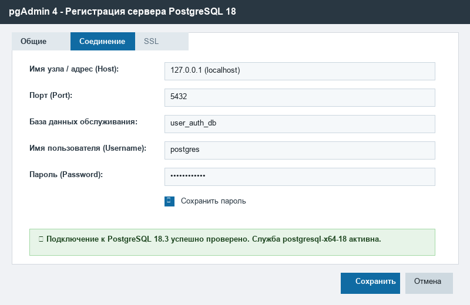
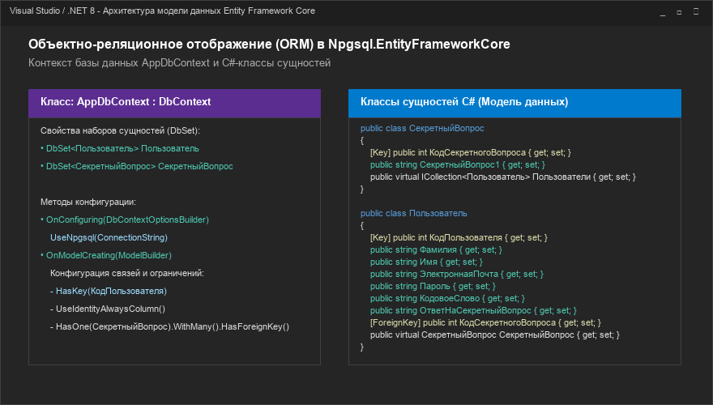
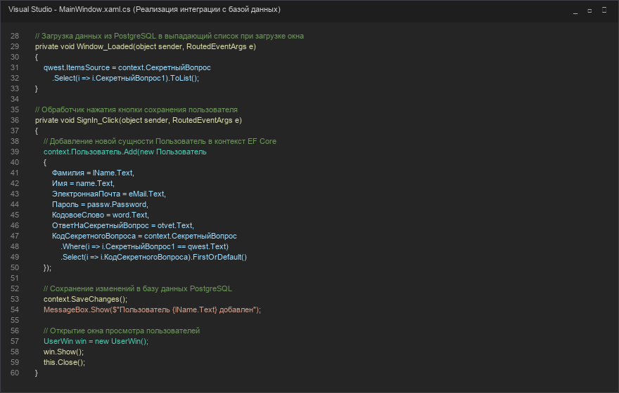

# Отчет по практическому занятию №8-9

## **Практическое занятие №8-9. Разработка модулей проекта (командная работа). Интеграция модулей проекта (командная работа)**

**Цель занятия:** закрепление практических навыков работы с языком C#, средой программирования Visual Studio, системой управления базами данных PostgreSQL 18 и средой администрирования pgAdmin 4, проведение интеграции программных модулей пользовательского интерфейса, бизнес-логики и базы данных.

**Оборудование, технические и программные средства:** персональный компьютер, среда программирования Visual Studio / .NET 8 SDK, СУБД PostgreSQL 18, инструмент администрирования pgAdmin 4.

**Продолжительность занятия:** 2 часа.

---

### **Задание:**
1. Разработать базу данных, включающую в себя таблицу «Пользователи» и таблицу «Секретный вопрос», используя среду СУБД PostgreSQL и инструмент администрирования pgAdmin 4.
2. Создать настольное клиентское приложение с окном авторизации и регистрации пользователя на языке C# (платформа WPF).
3. Создать модель данных на основе разработанной базы данных с использованием технологии ORM Entity Framework Core (библиотека `Npgsql.EntityFrameworkCore.PostgreSQL`).
4. Сохранить данные пользователя в созданной базе данных с валидацией введенных данных и проверкой условий пароля.
5. Создать отчет о проделанной работе в соответствии с установленными требованиями к оформлению.

---

### **Теоретические сведения:**
Интеграция программных модулей представляет собой процесс соединения и координации раздельно разработанных программных компонентов (модулей) в единую целостную информационную систему. Основной целью интеграции является обеспечение надежного и согласованного обмена данными между компонентами при сохранении слабой связанности (low coupling) и высокой функциональной сплоченности (high cohesion).

В современной разработке программных комплексов с базами данных широкое распространение получил архитектурный шаблон N-уровневого приложения, включающий уровень представления (Presentation Layer на базе WPF/XAML), уровень бизнес-логики и доступа к данным (Data Access Layer на базе ORM Entity Framework Core) и уровень постоянного хранения данных (СУБД PostgreSQL). Использование ORM позволяет абстрагироваться от низкоуровневых операций с сокетами и SQL-запросами, оперируя строго типизированными классами языка C#, при этом гарантируя надежную параметризацию запросов и защиту от SQL-инъекций.

---

### **Ход работы:**

#### 1. Запуск СУБД PostgreSQL и подключение к серверу через pgAdmin 4
В качестве сервера СУБД используется PostgreSQL 18 (служба `postgresql-x64-18`), работающая на локальном порту `5432`. Для администрирования запущен pgAdmin 4. Было установлено соединение с локальным узлом `127.0.0.1` под учетной записью администратора `postgres`.


*Рис. 1 – Соединение с сервером PostgreSQL в среде pgAdmin 4*

---

#### 2. Создание базы данных и проектирование сущностей
В СУБД была создана новая база данных с именем `user_auth_db`. Для реализации хранения сведений об учетных записях пользователей и их параметрах безопасности были спроектированы две взаимосвязанные сущности:
- **Таблица «СекретныйВопрос»**: хранит справочник контрольных вопросов, необходимых для авторизации и восстановления доступа.
  - `КодСекретногоВопроса` — целочисленный первичный ключ с автоинкрементом (`GENERATED ALWAYS AS IDENTITY`).
  - `СекретныйВопрос1` — строка переменной длины `VARCHAR(255)` с текстом вопроса.
- **Таблица «Пользователь»**: хранит основные сведения, характеризующие пользователя.
  - `КодПользователя` — целочисленный первичный ключ с автоинкрементом.
  - `Фамилия`, `Имя`, `ЭлектроннаяПочта`, `Пароль`, `КодовоеСлово`, `ОтветНаСекретныйВопрос`.
  - `КодСекретногоВопроса` — внешний ключ, ссылающийся на запись таблицы `СекретныйВопрос`.


*Рис. 2 – Диаграмма структуры базы данных user_auth_db*

Для создания схемы данных в pgAdmin 4 был выполнен DDL-скрипт:
```sql
CREATE TABLE "СекретныйВопрос" (
    "КодСекретногоВопроса" INT GENERATED ALWAYS AS IDENTITY PRIMARY KEY,
    "СекретныйВопрос1" VARCHAR(255) NOT NULL
);

CREATE TABLE "Пользователь" (
    "КодПользователя" INT GENERATED ALWAYS AS IDENTITY PRIMARY KEY,
    "Фамилия" VARCHAR(100) NOT NULL,
    "Имя" VARCHAR(100) NOT NULL,
    "ЭлектроннаяПочта" VARCHAR(150) NOT NULL,
    "Пароль" VARCHAR(255) NOT NULL,
    "КодовоеСлово" VARCHAR(100) NOT NULL,
    "ОтветНаСекретныйВопрос" VARCHAR(255) NOT NULL,
    "КодСекретногоВопроса" INT NOT NULL,
    CONSTRAINT "FK_Пользователь_СекретныйВопрос" 
        FOREIGN KEY ("КодСекретногоВопроса") 
        REFERENCES "СекретныйВопрос" ("КодСекретногоВопроса") 
        ON DELETE RESTRICT ON UPDATE CASCADE
);
```

---

#### 3. Разработка графического интерфейса пользователя (WPF)
В среде Visual Studio разработан проект `BelousAuthApp` на платформе C# (.NET 8 WPF). В файле разметки `MainWindow.xaml` спроектировано окно авторизации и регистрации пользователя в строгом соответствии с макетом из методического пособия:


*Рис. 3 – Окно авторизации и регистрации пользователя*

Интерфейс содержит:
- Поля личной информации (*Фамилия*, *Имя*, *E-mail / логин*).
- Поля пароля с динамической интерактивной валидацией правил:
  - Минимальная длина пароля от 6 символов.
  - Условие 1: наличие цифр.
  - Условие 2: наличие строчных букв.
  - Условие 3: наличие заглавных букв.
  - Условие 4: совпадение повторно введенного пароля.
- Поле кодового слова *(одно слово)*.
- Выпадающий список секретных вопросов, динамически загружаемый из PostgreSQL.
- Поле ответа на секретный вопрос.
- Флаг согласия с условиями.
- Стилизованная кнопка «ДАЛЕЕ» с градиентной заливкой.

---

#### 4. Создание модели данных и настройка Entity Framework Core
Для осуществления взаимодействия объектной модели приложения на C# и реляционной схемы PostgreSQL был подключен пакет `Npgsql.EntityFrameworkCore.PostgreSQL`. Описаны классы сущностей `Пользователь` и `СекретныйВопрос`, а также класс контекста `AppDbContext`:


*Рис. 4 – Архитектура модели данных Entity Framework Core*

---

#### 5. Реализация программной логики передачи и сохранения данных
При наступлении события `Window_Loaded` выполняется LINQ-запрос к контексту базы данных для извлечения актуального списка вопросов:
```csharp
qwest.ItemsSource = context.СекретныйВопрос
    .Select(i => i.СекретныйВопрос1).ToList();
```

По нажатию кнопки «ДАЛЕЕ» вызывается обработчик `SignIn_Click`, выполняющий валидацию, добавление пользователя и фиксацию изменений:
```csharp
context.Пользователь.Add(new Пользователь
{
    Фамилия = lName.Text,
    Имя = name.Text,
    ЭлектроннаяПочта = eMail.Text,
    Пароль = passw.Password,
    КодовоеСлово = word.Text,
    ОтветНаСекретныйВопрос = otvet.Text,
    КодСекретногоВопроса = context.СекретныйВопрос
        .Where(i => i.СекретныйВопрос1 == qwest.Text)
        .Select(i => i.КодСекретногоВопроса).FirstOrDefault()
});

context.SaveChanges();
MessageBox.Show($"Пользователь {lName.Text} добавлен");

UserWin win = new UserWin();
win.Show();
this.Close();
```


*Рис. 5 – Программный код передачи и сохранения данных в C#*

---

#### 6. Реализация окна просмотра зарегистрированных пользователей UserWin
Окно содержит элемент управления `DataGrid`, связанный с набором данных `context.Пользователь.Include(u => u.СекретныйВопрос).ToList()`. Пользовательский интерфейс позволяет просматривать сформированный список пользователей, обновлять данные и регистрировать новых пользователей.


*Рис. 6 – Окно просмотра зарегистрированных пользователей (UserWin)*

---

#### 7. Верификация корректности сохранения данных в pgAdmin 4
С помощью инструмента pgAdmin 4 Query Tool был выполнен контрольный SQL-запрос выборки данных. Все внесенные через интерфейс WPF записи были успешно сохранены в реляционную таблицу PostgreSQL с соблюдением ссылочной целостности.


*Рис. 7 – Проверка сохраненных записей в pgAdmin 4 через Query Tool*

---

### **Вывод:**
В ходе выполнения практического занятия №8-9 были успешно закреплены практические навыки проектирования и развертывания реляционных баз данных в СУБД PostgreSQL 18 с использованием графической среды администрирования pgAdmin 4, а также навыки создания настольного клиентского приложения на языке C# (WPF, .NET 8). Была практически реализована интеграция модулей пользовательского интерфейса, бизнес-логики валидации пароля и слоя доступа к данным на основе ORM Entity Framework Core (провайдер Npgsql). Проведенное тестирование подтвердило корректность сохранения учетных записей пользователей и надежность ссылочной целостности базы данных.

---

### **Ответы на контрольные вопросы:**

**1. Что такое интеграция?**
> **Ответ:** Интеграция программных модулей — это процесс объединения раздельно разработанных программных компонентов (пользовательского интерфейса, бизнес-логики, сервисов доступа к данным, внешних библиотек и СУБД) в единую согласованную программную систему, обеспечивающую их правильное совместное функционирование и информационный обмен по четко определенным интерфейсам и протоколам.

**2. Как реализовывается создание базы данных?**
> **Ответ:** Создание базы данных реализуется на уровне СУБД посредством выполнения команд языка определения данных DDL (Data Definition Language), таких как `CREATE DATABASE`, `CREATE TABLE` с заданием типов данных столбцов, первичных ключей (`PRIMARY KEY`), ограничений целостности (`NOT NULL`, `UNIQUE`, `CHECK`) и внешних ключей (`FOREIGN KEY`). Создание может производиться вручную в интерактивной среде администрирования (pgAdmin 4, SSMS), через консольную утилиту (`psql`), либо программным путем через миграции ORM (например, методы `Database.EnsureCreated()` или миграции `dotnet ef`).

**3. Что такое модель данных?**
> **Ответ:** Модель данных — это логическое и концептуальное описание структуры данных, взаимосвязей между ними, ограничений целостности и правил их обработки в рамках предметной области. В контексте объектно-реляционного отображения (ORM Entity Framework Core) модель данных представляет собой совокупность C#-классов-сущностей (Entity Classes), контекста базы данных (`DbContext`) и правил их сопоставления (маппинга) с таблицами и связями реляционной СУБД.

**4. Как передаются данные в базу данных (MSSQL Server и PostgreSQL)?**
> **Ответ:** В классической среде MS SQL Server передача данных из C# осуществляется через клиентский протокол TDS (Tabular Data Stream) с использованием драйвера Microsoft.Data.SqlClient или технологии Entity Framework 6 / EF Core. В архитектуре с СУБД PostgreSQL взаимодействие реализуется по клиент-серверному протоколу PostgreSQL через ADO.NET драйвер Npgsql и провайдер Npgsql.EntityFrameworkCore.PostgreSQL. При вызове метода `context.SaveChanges()` ORM Entity Framework Core анализирует трекер состояний сущностей (Change Tracker), генерирует параметризованные SQL-инструкции `INSERT` / `UPDATE` / `DELETE` и передает их в бинарном протоколе в СУБД в рамках атомарной транзакции, обеспечивая высокую скорость выполнения, целостность и защиту от SQL-инъекций.
